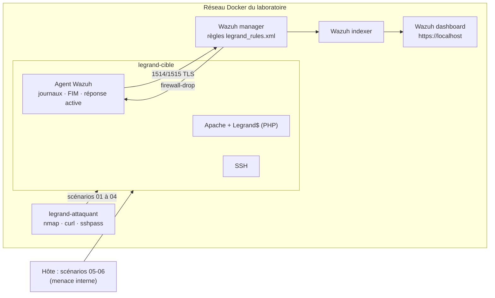

# Legrand SOC — Laboratoire de détection et de réponse aux incidents (Wazuh · MITRE ATT&CK)

Mini-SOC conteneurisé qui **attaque, détecte et répond**. Une application bancaire volontairement vulnérable (**Legrand$**) est supervisée par **Wazuh** (SIEM/XDR open source). Six scénarios d'attaque rejouent une intrusion complète, de la reconnaissance à l'élévation de privilèges. **14 règles de détection personnalisées** reliées à MITRE ATT&CK lèvent les alertes, une **réponse active** bloque automatiquement l'attaquant, et des **playbooks** (NIST SP 800-61) guident l'analyste jusqu'au rapport d'incident.

> ⚠️ L'application `cible/` contient des vulnérabilités **volontaires** (injection SQL, mots de passe faibles). Elle n'est publiée que sur `127.0.0.1` : ne jamais l'exposer.

## Architecture



## Ce que le projet démontre

| Exigence d'un poste de RSSI | Réalisation |
|---|---|
| Dispositifs de détection | SIEM Wazuh, collecte des journaux Apache, applicatifs (JSON), auth.log ; surveillance d'intégrité en temps réel |
| Ingénierie de détection | 14 règles personnalisées : corrélation temporelle (force brute → succès), seuils, PCRE2, FIM — voir [la matrice MITRE](docs/matrice-mitre.md) |
| Réponse aux incidents | Réponse active automatique et 5 playbooks (force brute, injection SQL, webshell, élévation de privilèges, rançongiciel) |
| Reporting | [Modèle de rapport d'incident](rapports/MODELE-rapport-incident.md) et [rapport d'exercice rempli](rapports/INC-2026-001-exercice-intrusion-legrand-banque.md) |
| Sécurité dès la conception (DevSecOps) | Pipeline : Semgrep (SAST), Trivy (image et IaC), Hadolint, ShellCheck, Gitleaks, validation des règles |
| Continuité et amélioration | Retour d'expérience relié aux risques et mesures ISO 27002 de [Legrand GRC](https://github.com/Flav-legrand/legrand-grc) |

## Démarrage

**Prérequis :** Docker et Docker Compose v2, git, **8 Go de RAM** disponibles pour Docker (4 cœurs recommandés). Sous Windows : Docker Desktop avec WSL 2. Une instance AWS EC2 `t3.large` convient aussi.

```bash
# Linux / WSL uniquement (exigence de l'indexer OpenSearch)
sudo sysctl -w vm.max_map_count=262144

git clone https://github.com/Flav-legrand/legrand-soc.git && cd legrand-soc
./setup.sh                         # clone wazuh-docker (v4.14.6), certificats, surcouche, démarrage
```

`setup.sh` s'appuie sur la **pile officielle** `wazuh-docker` (single-node) et lui ajoute :
- les règles `wazuh/rules/legrand_rules.xml`, montées en lecture seule dans le manager ;
- la réponse active `firewall-drop` (insérée dans `wazuh_manager.conf`) ;
- les conteneurs `legrand-cible` (Apache, PHP, SSH, agent Wazuh) et `legrand-attaquant`.

Une autre version de Wazuh se choisit avec `WAZUH_VERSION=4.x.y ./setup.sh` (garder la même version pour le manager et l'agent).

**Avant la démonstration, changez les mots de passe par défaut** du tableau de bord et de l'API, en suivant la documentation officielle de wazuh-docker.

## Rejouer l'attaque

```bash
./scripts/lancer-scenarios.sh      # toute la chaîne, avec une pause de 20 s entre les étapes
# ou étape par étape :
docker exec legrand-attaquant /scenarios/02-force-brute-web.sh
./scripts/reinitialiser-cible.sh   # remise à zéro de la cible
```

| # | Scénario | Technique | Alerte attendue |
|---|---|---|---|
| 01 | Scan de ports et énumération web | T1595 | 100120, 100121 |
| 02 | Force brute sur l'espace client, puis succès | T1110.001 → T1078 | 100102 → **100103** + blocage IP |
| 03 | Injection SQL et extraction de la table clients | T1190, T1005 | 100110, 100111, **100112** |
| 04 | Force brute SSH, puis succès | T1110.001, T1021.004 | 5712 → **100130** |
| 05 | Dépôt d'un fichier PHP dans le site (fichier inoffensif) | T1505.003 | **100150** |
| 06 | Création de compte et ajout au groupe sudo | T1136, T1098 | 5902, **100140**, 100151 |

Dans le tableau de bord : **Threat Hunting → Events**, filtre `rule.groups: legrand`, ou **MITRE ATT&CK → Framework** pour la vue par tactique.

## Valider une règle sans attaque

```bash
docker exec -it single-node-wazuh.manager-1 /var/ossec/bin/wazuh-logtest
# coller une ligne de wazuh/logtest/echantillons.log : la règle déclenchée et son niveau s'affichent
```

## Arborescence

```
setup.sh                    installation et démarrage
docker-compose.soc.yml      surcouche de la pile Wazuh officielle
wazuh/rules/                règles de détection personnalisées (100100–100199)
wazuh/active-response.xml   blocage automatique
wazuh/logtest/              échantillons de journaux pour tester les règles
cible/                      application Legrand$ vulnérable, SSH, configuration de l'agent
attaquant/scenarios/        scénarios 01 à 04 (exécutés depuis le conteneur attaquant)
scripts/                    scénarios 05-06 (menace interne), enchaînement, réinitialisation
playbooks/                  procédures de réponse (NIST SP 800-61)
rapports/                   modèle et exemple de rapport d'incident
docs/                       matrice MITRE, captures
.github/workflows/          pipeline DevSecOps
```

## Captures

*À ajouter dans `docs/captures/` après la première exécution : alertes `legrand`, vue MITRE ATT&CK, détail de l'alerte 100103, journal de la réponse active, rapport SARIF Semgrep.*

---

**Auteur :** Elyse Flav-Legrand Mongouo — Ingénieur en Génie Numérique, certifié Google Cybersecurity · [Portfolio](https://mongouo-portfolio.mongouoflav.workers.dev/) · GitHub [Flav-legrand](https://github.com/Flav-legrand)
